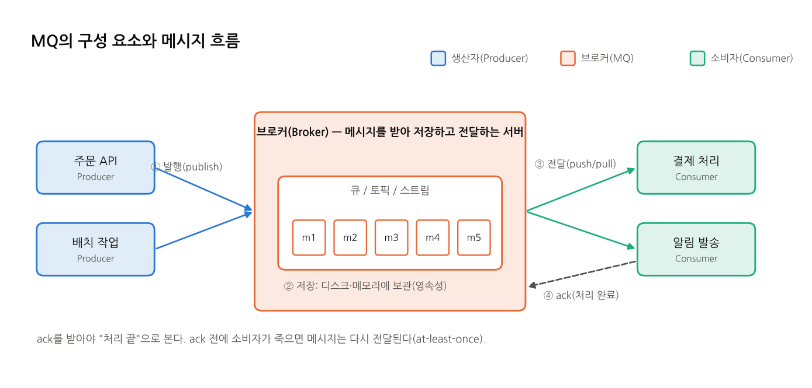
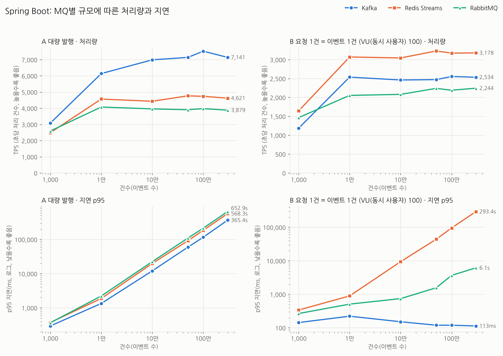

# MQ Benchmark: Kafka vs Redis Streams vs RabbitMQ

대표 메시지 큐(MQ) 세 가지, **Kafka, Redis Streams, RabbitMQ**를 같은 조건에서 비교하는 프로젝트다.
**Spring Boot**와 **NestJS** 두 백엔드로 같은 시나리오를 구현해서, MQ 차이와 프레임워크 차이를 함께 본다.

이 저장소로 할 수 있는 일은 세 가지다.

| 목적 | 내용 | 시작점 |
|---|---|---|
| **성능 비교** | 1천~300만 건 규모에서 MQ 3종 × Spring·Nest의 처리량(TPS)과 지연을 측정한 결과와 재현 스크립트 | [reports/scale-result.md](reports/scale-result.md) |
| **재사용 가능한 MQ 모듈** | MQ별로 나뉜 연동 코드(설정 포함). 새 프로젝트에 폴더째 복사해 바로 쓴다 | [spring/README.md](spring/README.md), [nest/README.md](nest/README.md) |
| **학습** | MQ 개념 정리(그림 포함), CLI·GUI·코드·API로 해 보는 실습 | [docs/mq/](docs/mq/README.md), [practice/](practice/README.md) |



## 결과 한눈에 보기
4코어 머신 한 대, 메시지 256B, DB 저장 포함, k6로 측정했다(앱당 114회).

| 질문 | 결과 |
|---|---|
| 쌓인 메시지를 가장 빨리 비우는 MQ (방식 A: 대량 발행) | **Spring: Kafka** (약 7,000~7,500 TPS, 6개 규모 모두 1위) / **Nest: Kafka ≈ Redis** |
| API 요청을 가장 많이 받아내는 MQ (방식 B: 요청 1건 = 이벤트 1건, VU(동시 사용자) 100) | **두 앱 모두 Redis Streams**. 다만 컨슈머가 밀려 지연이 쌓인다 |
| B에서 지연이 가장 짧은 조합 | **Spring + Kafka** (300만 건에서도 p95 0.1초대) |
| Spring vs Nest | A는 Nest가 약 1.2배, B는 Spring이 약 1.15배 빠르다 |
| 규모를 키우면 | 처리량은 1만~10만 건부터 평탄하고, MQ 순위는 거의 바뀌지 않는다 |



자세한 수치, Nest 결과, Spring vs Nest 비교 그래프, 해석은 [성능 측정 결과](reports/scale-result.md)에 있다.

## 빠른 시작
필요한 것: Docker, JDK 21(Spring), Node 20 이상(Nest), k6(부하 테스트)

```bash
# 1) 인프라: MariaDB, Redis, Kafka(KRaft), RabbitMQ
docker compose up -d
#    GUI까지 띄우려면(RedisInsight, Kafka UI)
docker compose --profile gui up -d

# 2) 앱 하나 실행 (Nest와 Spring을 동시에 띄우지 않는다)
cd spring && ./gradlew bootRun                    # http://localhost:8080
# 또는
cd nest && npm install && npm run start:dev       # http://localhost:3000

# 3) 한 번 재 보기
curl "localhost:8080/bench/kafka?count=10000&size=256&db=true"     # 방식 A
k6 run -e BASE=http://localhost:8080 -e MQ=kafka -e COUNT=10000 -e VUS=100 load/k6/orders.js   # 방식 B

# 4) 전체 시나리오(1천~300만, A·B × MQ 3종)
./scenarios.sh spring
```

### 접속 정보
원래 포트 앞에 `3`을 붙인 외부 포트를 쓴다.

| 서비스 | 주소 | 계정 |
|---|---|---|
| MariaDB | `localhost:33307` | root / 1234 (DB `bench`) |
| Redis | `localhost:36397` | 없음 |
| Kafka | `localhost:39092` | 없음 |
| RabbitMQ | `localhost:35672`, 관리 UI http://localhost:31567 | guest / guest |
| RedisInsight (`gui` 프로필) | http://localhost:35540 | 없음 |
| Kafka UI (`gui` 프로필) | http://localhost:38080 | 없음 |

## 기술 구성
| | Spring Boot | NestJS |
|---|---|---|
| 런타임 | Spring Boot 3.4, Java 21, Gradle | NestJS 10, TypeScript, Node |
| Kafka | `spring-kafka` | `kafkajs` |
| Redis Streams | `spring-boot-starter-data-redis` (Lettuce) | `ioredis` |
| RabbitMQ | `spring-boot-starter-amqp` | `amqplib` |
| 설정 | `application.properties` + MQ별 `application-<mq>.properties` | `@nestjs/config` + `.env` |
| DB | MariaDB (`JdbcTemplate`, 풀 10) | MariaDB (`mysql2`, 풀 10) |

두 앱 모두 MQ별 모듈(`mq/kafka`, `mq/rabbitmq`, `mq/redis…`)이 벤치마크 코드와 분리돼 있다. 설정 한 줄로 MQ를 끄고 켤 수 있다.

## 폴더 구조
```
mq-benchmark/
├─ docker-compose.yml   # 브로커 4종 + GUI(gui 프로필)
├─ spring/              # Spring Boot 앱 (MQ 모듈, 벤치 API, 연습용 API)
├─ nest/                # NestJS 앱 (같은 구성)
├─ load/                # 부하 스크립트: k6, Locust
├─ scenarios.sh         # 규모별 시나리오 자동 실행
├─ report.py, compare.py, charts.py   # 결과 → 표, 비교표, 그래프
├─ reports/             # 측정 결과 리포트, 원본 데이터, 그래프
├─ docs/                # MQ 개념(docs/mq), k6·Locust 가이드, Node vs Spring 개념
└─ practice/            # MQ 실습: CLI 스크립트, Node·Java 예제, GUI 사용법
```

## 문서 안내
| 알고 싶은 것 | 문서 |
|---|---|
| MQ가 무엇이고 왜 쓰는지, 세 MQ의 구조와 장단점 | [docs/mq/](docs/mq/README.md) |
| 시나리오 A·B와 VU(동시 사용자)의 뜻, 측정 방법 | [SCENARIOS.md](SCENARIOS.md) |
| 부하 도구 사용법 | [docs/k6-guide.md](docs/k6-guide.md), [docs/locust-guide.md](docs/locust-guide.md) |
| 성능 측정 결과와 해석 | [reports/scale-result.md](reports/scale-result.md) |
| Node(Nest)와 Spring의 차이(개념) | [docs/nest-vs-spring-concepts.md](docs/nest-vs-spring-concepts.md) |
| MQ 직접 다뤄 보기(CLI, GUI, 코드, API) | [practice/README.md](practice/README.md) |
| 앱 구조, 설정, MQ 모듈을 다른 프로젝트로 가져가는 법 | [spring/README.md](spring/README.md), [nest/README.md](nest/README.md) |
| 처음부터 끝까지 테스트 절차 | [GUIDE.md](GUIDE.md) |

## 알아 둘 점
- 모든 브로커는 **단일 노드**다. 클러스터, 복제 환경의 성능과는 다르다.
- 측정값은 브로커, DB, 앱, 부하 도구가 한 머신을 나눠 쓴 결과다. 절대 수치보다 상대 비교로 본다.
- 두 앱은 각 프레임워크에서 흔히 쓰는 방식으로 컨슈머를 구현해서 처리 방식이 다르다(Nest는 묶어서 동시 처리, Spring은 스레드마다 건별 처리). 프레임워크가 강제하는 것은 아니라 바꿀 수 있다. 그래서 Spring과 Nest의 차이에는 런타임 차이와 구현 차이가 섞여 있다. 이유와 측정 해석은 [docs/nest-vs-spring-concepts.md](docs/nest-vs-spring-concepts.md)의 7절에 있다.
  - **바꾸는 방법**
    - Spring을 묶음 처리로: Kafka·RabbitMQ는 배치 리스너(`List<String>`으로 받기), Redis는 `XREADGROUP COUNT 100`으로 직접 읽어 한 번에 ack
    - Nest를 건별 처리로: Kafka는 `eachMessage`, Redis는 한 건씩 처리하고 건마다 ack, RabbitMQ는 채널마다 prefetch 1
    - 코드 세팅법: [spring/README.md](spring/README.md), [nest/README.md](nest/README.md)의 "컨슈머 처리 방식 바꾸기" 절
