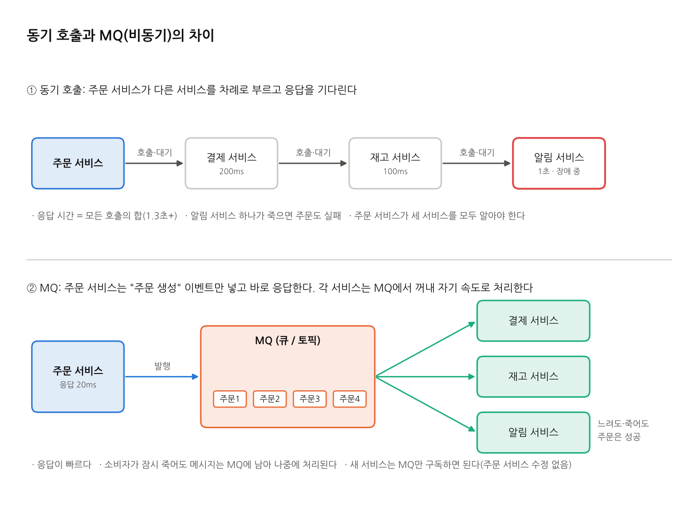
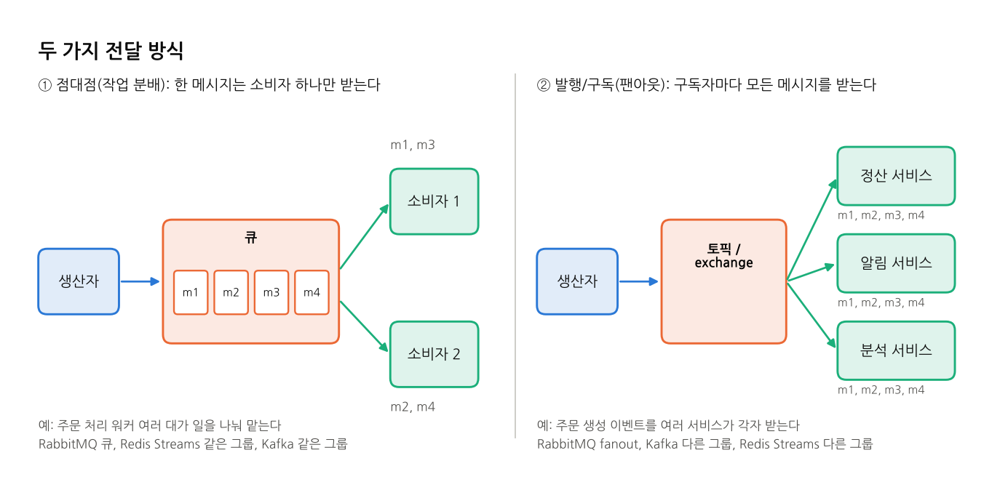

# MQ(메시지 큐)란

## 한 줄 정의
**MQ(Message Queue)는 서비스 사이에서 메시지를 받아 보관했다가, 받을 쪽이 준비되면 넘겨 주는 중간 저장소(브로커)다.**
보내는 쪽과 받는 쪽이 서로를 직접 부르지 않고, MQ를 사이에 두고 메시지만 주고받는다.

비유하면 **택배 보관함**이다. 보내는 사람은 보관함에 넣고 바로 자기 일을 하러 간다. 받는 사람은 자기 시간에 꺼내 간다. 받는 사람이 잠시 없어도 물건은 보관함에 남아 있다.

## 왜 쓰나

| 이유 | 설명 | 예 |
|---|---|---|
| **비동기 처리** | 오래 걸리는 일을 뒤로 미루고 바로 응답한다 | 주문 API는 "주문 생성" 이벤트만 넣고 응답. 메일 발송은 나중에 |
| **결합도 낮추기** | 보내는 쪽은 받는 쪽이 누구인지, 몇 개인지 몰라도 된다 | 새 서비스(포인트 적립)를 추가해도 주문 서비스는 수정하지 않는다 |
| **트래픽 완충(버퍼)** | 요청이 몰려도 MQ에 쌓아 두고, 소비자는 감당할 수 있는 속도로 꺼낸다 | 이벤트 오픈 순간 몰린 주문을 DB가 버틸 속도로 처리 |
| **확장** | 소비자를 늘리면 처리량이 늘어난다 | 워커 2대 → 10대 |
| **장애 격리** | 소비자가 잠시 죽어도 메시지는 남아 있다가 복구 후 처리된다 | 알림 서비스 장애가 주문 실패로 번지지 않는다 |

## 구성 요소

| 구성 요소 | 역할 |
|---|---|
| **생산자(Producer, Publisher)** | 메시지를 만들어 MQ에 보낸다(발행, publish) |
| **브로커(Broker)** | 메시지를 받아 저장하고 소비자에게 넘겨 주는 서버. Kafka, RabbitMQ, Redis가 여기에 해당한다 |
| **큐 / 토픽 / 스트림** | 브로커 안에서 메시지가 쌓이는 곳의 이름. MQ마다 부르는 이름과 동작이 조금씩 다르다 |
| **소비자(Consumer, Subscriber)** | 메시지를 받아 처리한다 |
| **ack(확인 응답)** | 소비자가 "처리 끝"이라고 브로커에 알리는 것. ack를 받아야 브로커가 그 메시지를 완료로 본다 |

그림에서 색은 역할을 뜻한다: **파랑 = 생산자, 주황 = 브로커, 청록 = 소비자**. MQ별 문서의 그림도 같은 색을 쓴다.

## 두 가지 전달 방식

| 방식 | 동작 | 쓰임새 |
|---|---|---|
| **점대점(Point-to-Point, 작업 분배)** | 메시지 하나를 소비자 **하나**만 받는다. 소비자가 여럿이면 나눠 갖는다 | 주문 처리, 이미지 변환처럼 일을 여러 워커가 나눠서 할 때 |
| **발행/구독(Pub/Sub, 팬아웃)** | 메시지 하나를 구독자 **모두**가 받는다 | 주문 생성 이벤트를 정산, 알림, 분석 서비스가 각자 받을 때 |

세 MQ 모두 두 방식을 다 할 수 있다. 방법이 다를 뿐이다.
- **RabbitMQ:** 같은 큐에 소비자 여럿이면 점대점, fanout exchange로 큐 여러 개에 복사하면 발행/구독이다.
- **Kafka, Redis Streams:** 같은 컨슈머 그룹이면 점대점이고, 그룹이 다르면 각자 전부 받으므로 발행/구독이다.

## 꼭 알아야 할 개념

### 전달 보장
| 수준 | 뜻 | 대가 |
|---|---|---|
| **at-most-once** (최대 한 번) | 잃어버릴 수는 있지만 중복은 없다. 받자마자 ack하는 방식 | 장애 시 메시지 유실 |
| **at-least-once** (최소 한 번) | 잃어버리지 않지만 **중복될 수 있다**. 처리 후 ack하는 방식. 가장 많이 쓴다 | 소비자가 중복을 견뎌야 한다 |
| **exactly-once** (정확히 한 번) | 유실도 중복도 없다 | 구현이 복잡하고 느리다. Kafka 트랜잭션처럼 특정 범위에서만 보장된다 |

이 프로젝트는 세 MQ 모두 **at-least-once**다. 처리 후 ack하고, 중복은 DB의 `INSERT IGNORE`로 걸러 낸다.

### 멱등성(Idempotency)
같은 메시지를 두 번 처리해도 결과가 한 번 처리한 것과 같아야 한다. at-least-once에서는 중복이 생길 수 있어서 거의 필수다.
- 방법: 메시지 ID를 기본 키로 저장(중복이면 무시), "이미 처리한 ID" 기록, 상태를 덮어쓰는 방식의 갱신

### push와 pull
| 방식 | 동작 | 대표 |
|---|---|---|
| **push** | 브로커가 소비자에게 밀어 준다. 소비자가 감당할 만큼만 받도록 prefetch로 조절한다 | RabbitMQ |
| **pull** | 소비자가 브로커에게 "있으면 줘"라고 가져간다. 자기 속도대로 읽는다 | Kafka, Redis Streams |

### 순서
- 큐 하나, 소비자 하나면 순서가 지켜진다.
- 소비자가 여럿이면 처리 순서는 섞인다.
- Kafka는 **파티션 안에서만** 순서를 보장한다. 같은 key는 같은 파티션으로 가므로, 예를 들어 같은 사용자의 이벤트는 순서가 지켜진다.

### 영속성(Durability)
브로커가 재시작돼도 메시지가 남는지를 말한다.
- RabbitMQ: durable 큐 + persistent 메시지
- Kafka: 디스크 로그(기본)
- Redis: AOF/RDB 설정

이 프로젝트는 세 MQ 모두 영속성을 켰다.

### 보존(Retention)
| MQ | 처리된 메시지 |
|---|---|
| RabbitMQ | ack하면 **사라진다** |
| Kafka | ack(커밋)와 상관없이 **보존 기간 동안 남는다**. 다시 읽기(재처리)가 가능 |
| Redis Streams | 지우거나 잘라낼 때까지 남는다(`XTRIM`, `XDEL`) |

## 단점과 주의할 점
| 주의할 점 | 내용 |
|---|---|
| 구조가 복잡해진다 | 운영할 서버(브로커)가 하나 늘고, 흐름을 따라가기 어려워진다(요청 → MQ → 어느 소비자?) |
| 중복과 순서 | at-least-once면 중복이 생긴다. 소비자가 여럿이면 순서가 섞인다. 둘 다 코드에서 대비해야 한다 |
| 최종 일관성 | 저장이 "나중에" 끝난다. 사용자가 방금 한 주문이 목록에 바로 안 보일 수 있다 |
| 쌓임(백로그) 감시 | 소비가 생산보다 느리면 메시지가 쌓이고 지연이 커진다. 큐 길이, 컨슈머 lag을 모니터링해야 한다 |
| 실패 메시지 처리 | 계속 실패하는 메시지를 따로 빼 두는 곳(DLQ, Dead Letter Queue)과 재시도 정책이 필요하다 |

## 대표 MQ 세 가지 한눈에 보기
| 항목 | Redis Streams | RabbitMQ | Kafka |
|---|---|---|---|
| 한 줄 요약 | Redis에 들어 있는 가벼운 로그형 MQ | 라우팅이 유연한 전통적 메시지 브로커 | 대용량 이벤트를 위한 분산 로그 |
| 저장 모델 | 로그(스트림 키) | 큐(소비하면 삭제) | 로그(토픽·파티션) |
| 처리 후 메시지 | 남음 | 사라짐 | 보존 기간 동안 남음 |
| 전달 방식 | pull (`XREADGROUP`) | push (prefetch) | pull (`poll`) |
| 나눠 받는 단위 | 컨슈머 그룹 | 같은 큐의 소비자 | 컨슈머 그룹(파티션 단위) |
| 순서 | 스트림 안 | 큐 안(소비자 1개일 때) | 파티션 안 |
| 라우팅 | 없음(스트림 이름으로 구분) | exchange·binding으로 유연 | 토픽·key로 단순 |
| 재처리(다시 읽기) | ID 지정으로 가능 | 어려움(소비하면 삭제) | 오프셋 되감기로 쉬움 |
| 저장 한계 | 메모리 크기 | 디스크(쌓이면 성능 저하) | 디스크(대용량에 강함) |
| 운영 난이도 | 쉬움(이미 Redis를 쓰면 추가 없음) | 보통 | 높음 |
| 잘 맞는 곳 | 가벼운 비동기 작업, 작은 서비스 | 작업 큐, 복잡한 라우팅, 재시도·DLQ | 로그·이벤트 수집, 스트리밍, 여러 서비스가 같은 데이터 소비 |

MQ별 자세한 설명은 각 문서에 있다.
- [Redis Streams](02-redis-streams.md)
- [RabbitMQ](03-rabbitmq.md)
- [Kafka](04-kafka.md)

이 프로젝트에서 같은 조건으로 잰 성능은 [성능 비교 결과](../../reports/scale-result.md)를 본다.
