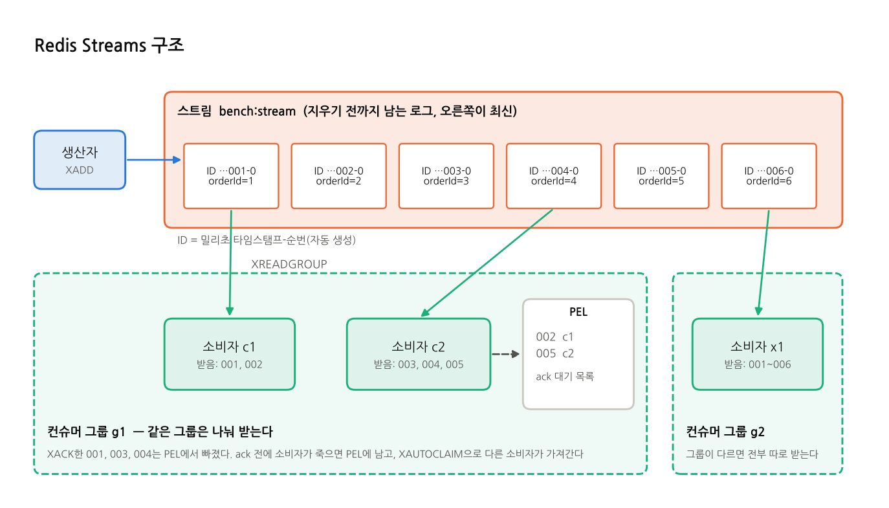

# Redis Streams

## 한 줄 요약
**Redis 안에 들어 있는 로그형 메시지 구조.** 이미 Redis를 쓰고 있다면 브로커를 새로 띄우지 않고 MQ를 쓸 수 있다.

## 등장 배경
- Redis는 메모리 기반 키-값 저장소로, 원래 캐시와 세션 용도로 많이 쓴다.
- 예전에는 Redis로 메시지를 주고받을 때 Pub/Sub이나 List(`LPUSH`/`BRPOP`)를 썼다. 각각 한계가 있었다.
  - Pub/Sub은 저장하지 않는다. 구독자가 없으면 메시지가 사라진다.
  - List는 한 번 꺼내면 끝이라 여러 소비자 그룹이나 ack를 다루기 어렵다.
- 그래서 **Redis 5.0(2018)** 에 Kafka의 로그 개념을 가져온 **Streams**가 추가됐다. 메시지를 남겨 두고, 컨슈머 그룹과 ack를 지원한다.

## 구조

| 용어 | 뜻 |
|---|---|
| **스트림(Stream)** | 메시지가 순서대로 쌓이는 로그. Redis 키 하나다(예: `bench:stream`) |
| **엔트리(Entry)** | 메시지 하나. 필드-값 쌍을 담는다(예: `orderId=1`) |
| **ID** | 엔트리마다 붙는 `밀리초 타임스탬프-순번`(예: `1700000000000-0`). 자동 생성되고 항상 증가한다 |
| **컨슈머 그룹(Consumer Group)** | 같은 그룹의 소비자들이 엔트리를 **나눠** 받는다. 그룹마다 "어디까지 전달했는지(last-delivered-id)"를 따로 기억한다 |
| **소비자(Consumer)** | 그룹 안의 이름 붙은 읽기 주체(예: `consumer-0`) |
| **PEL(Pending Entries List)** | 전달됐지만 아직 ack되지 않은 엔트리 목록. 소비자가 죽으면 여기 남는다 |

## 메시지 흐름
1. **발행:** 생산자가 `XADD bench:stream * orderId 1`로 엔트리를 추가한다. ID는 자동으로 붙는다.
2. **그룹 생성:** `XGROUP CREATE bench:stream g1 $ MKSTREAM`으로 만든다. `$`는 지금 이후부터, `0`은 처음부터 읽는다는 뜻이다.
3. **소비:** 소비자가 `XREADGROUP GROUP g1 c1 COUNT 100 BLOCK 1000 STREAMS bench:stream >`로 아직 아무에게도 전달되지 않은 엔트리를 가져온다. 가져온 엔트리는 PEL에 들어간다.
4. **ack:** 처리를 마치면 `XACK bench:stream g1 <id>`로 PEL에서 뺀다.
5. **장애 복구:** 오래 ack되지 않은 엔트리는 `XAUTOCLAIM`(또는 `XCLAIM`)으로 다른 소비자가 가져와 처리한다.
6. **정리:** 엔트리는 자동으로 지워지지 않는다. `XADD ... MAXLEN ~ 100000`이나 `XTRIM`으로 길이를 제한한다.

## 특징
| 항목 | 내용 |
|---|---|
| 전달 보장 | 컨슈머 그룹 + `XACK`로 at-least-once. 재전달(XAUTOCLAIM)은 직접 구현해야 한다 |
| 전달 방식 | pull. `BLOCK` 옵션으로 새 메시지를 기다린다(롱 폴링) |
| 순서 | 스트림 하나 안에서는 ID 순서가 보장된다 |
| 영속성 | Redis의 AOF/RDB를 따른다. 이 프로젝트는 AOF(`appendonly yes`)를 켰다. AOF 기본 설정(`everysec`)은 장애 시 최근 1초 정도를 잃을 수 있다 |
| 보존 | 지우기 전까지 남는다. 길이(MAXLEN)나 ID(MINID) 기준으로 잘라 낸다 |
| 확장 | 스트림 하나는 Redis 노드 하나에 있다. 더 늘리려면 스트림을 여러 개로 나눈다(샤딩) |

## 장점과 단점
| 장점 | 단점 |
|---|---|
| 운영이 쉽다. 이미 Redis가 있으면 추가 인프라가 없다 | 메모리에 저장해서 쌓을 수 있는 양이 메모리 크기로 제한된다 |
| 지연이 매우 짧다(메모리 기반) | 재전달, DLQ 같은 기능을 직접 만들어야 한다 |
| 메시지가 남아서 ID로 다시 읽을 수 있다 | 스트림 하나가 노드 하나에 묶여, 아주 큰 처리량으로 늘리기 어렵다 |
| 명령이 단순하다(XADD, XREADGROUP, XACK) | 디스크 영속성이 Kafka·RabbitMQ보다 약하다(AOF 설정에 따라 다름) |

**잘 맞는 경우**
- 이미 Redis를 쓰는 서비스의 가벼운 비동기 작업(알림, 후처리)
- 메시지 양이 메모리에 들어가는 수준
- 지연이 중요한 경우

**안 맞는 경우**
- 몇 주씩 보관해야 하는 대량 이벤트
- 복잡한 라우팅
- 유실이 절대 안 되는 금융 거래 원장

## 이 프로젝트에서
| 항목 | 설정 |
|---|---|
| 스트림 / 그룹 | `bench:stream` / `bench-spring-group`, `bench-nest-group` |
| 소비자 | 10개(같은 그룹). 한 번에 최대 100건 읽기(`COUNT 100`), 1초 블로킹 |
| ack | 처리(DB 저장) 후 `XACK` |
| 영속성 | AOF 켬 |
| 클라이언트 | Nest `ioredis`, Spring `spring-boot-starter-data-redis`(Lettuce, `StreamMessageListenerContainer`) |
| 코드 | Nest `nest/src/mq/redis-stream/`, Spring `spring/src/main/java/com/bench/mq/redis/` |

**측정 결과 요약** (출처: [reports/scale-result.md](../../reports/scale-result.md), 4코어 머신, 10만 건 이상 기준)
- **A(대량 발행):** Spring 약 4,400~4,800 TPS로 2위, Nest 약 6,700~7,200 TPS로 Kafka와 비슷한 1~2위. Nest가 Spring보다 약 1.5배 빠르다. Nest 컨슈머는 100건씩 병렬 처리하고, Spring은 건별로 처리하는 차이가 크게 작용한 것으로 보인다.
- **B(요청 1건 = 이벤트 1건, VU(동시 사용자) 100):** 두 앱 모두 처리량 1위다(Spring 약 3,040~3,230, Nest 약 2,500~2,750 TPS). 다만 컨슈머가 유입을 따라가지 못해 지연이 쌓였다. Spring 300만 건에서 p95가 293초였다.

## 더 보기
- 실습(CLI, 코드 예제, 앱 API): [practice/redis.md](../../practice/redis.md)
- GUI(RedisInsight): [practice/gui.md](../../practice/gui.md#redisinsight-redis)
- 공식 문서: https://redis.io/docs/latest/develop/data-types/streams/
