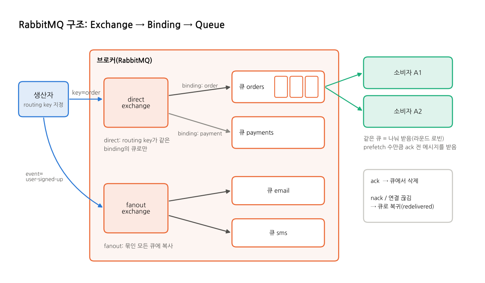

# RabbitMQ

## 한 줄 요약
**exchange와 binding으로 메시지를 원하는 큐에 유연하게 보내 주는 전통적인 메시지 브로커.** 작업 큐, 재시도, 라우팅이 필요한 곳에 많이 쓴다.

## 등장 배경
- 2007년에 Erlang으로 만들어진 오픈소스 브로커로, 지금은 Broadcom(VMware)이 관리한다.
- 금융권에서 만든 표준 메시징 프로토콜 **AMQP 0-9-1**을 구현했다. MQTT, STOMP도 플러그인으로 지원한다.
- "메시지를 큐에 넣고, 소비자가 처리하면 지운다"는 전통적인 MQ 모델이다. 여기에 exchange를 통한 라우팅이 강점이다.

## 구조

| 용어 | 뜻 |
|---|---|
| **exchange** | 생산자가 메시지를 보내는 곳. 생산자는 큐에 직접 넣지 않고 exchange에 보낸다 |
| **binding** | exchange와 큐를 잇는 규칙. "routing key가 `order`면 이 큐로" 같은 조건이 붙는다 |
| **routing key** | 생산자가 메시지에 붙이는 주소표. exchange가 이걸 보고 큐를 고른다 |
| **큐(Queue)** | 메시지가 쌓이는 곳. 소비자가 ack하면 지워진다 |
| **채널(Channel)** | TCP 연결 하나 안에서 여러 개 여는 가상 연결. 발행과 소비는 채널 위에서 한다 |
| **prefetch** | 소비자가 ack하지 않은 메시지를 최대 몇 개까지 받을지 정한다(흐름 제어) |
| **vhost** | 큐와 exchange를 묶는 논리 공간(기본 `/`) |

### exchange 종류
| 종류 | 규칙 | 예 |
|---|---|---|
| 기본(`""`) | routing key와 같은 이름의 큐로 | `sendToQueue('bench-queue', ...)`. 이 프로젝트의 벤치마크 |
| **direct** | routing key가 binding key와 **같은** 큐로 | `order`는 주문 큐, `payment`는 결제 큐 |
| **fanout** | 묶인 **모든** 큐로 복사(routing key 무시) | 가입 이벤트를 메일 큐, SMS 큐에 동시에 |
| **topic** | 패턴 매칭. `*`는 단어 하나, `#`는 0개 이상 | `order.*`는 `order.created`를 받고, `order.#`는 `order.payment.done`도 받는다 |
| headers | 헤더 값으로 매칭 | 드물게 쓴다 |

## 메시지 흐름
1. **발행:** 생산자가 exchange에 routing key를 붙여 보낸다(`basicPublish(exchange, routingKey, props, body)`).
2. **라우팅:** exchange가 binding 규칙에 맞는 큐(들)에 넣는다. 맞는 큐가 없으면 버려진다. `mandatory` 옵션으로 돌려받을 수도 있다.
3. **저장:** durable 큐에 persistent 메시지면 디스크에도 기록된다.
4. **전달(push):** 브로커가 소비자에게 밀어 준다. 소비자당 ack 안 된 메시지는 prefetch 수까지만 보낸다.
5. **ack:** 소비자가 처리 후 `basicAck`하면 큐에서 삭제된다.
6. **실패 처리:**
   - `nack`/`reject`하면 메시지를 다시 넣거나(requeue), 설정한 **DLX(Dead Letter Exchange)** 로 보낸다.
   - ack 없이 연결이 끊기면 자동으로 큐에 돌아가고, 다시 전달될 때 `redelivered=true`가 된다.

## 특징
| 항목 | 내용 |
|---|---|
| 전달 보장 | 수동 ack로 at-least-once. 발행 쪽은 publisher confirm으로 브로커 저장을 확인할 수 있다 |
| 전달 방식 | push(+prefetch). `basic.get`으로 한 건씩 당겨 올 수도 있다 |
| 순서 | 큐 안에서는 들어온 순서. 소비자가 여럿이거나 재큐잉되면 섞인다 |
| 영속성 | durable 큐 + persistent 메시지(`deliveryMode=2`) |
| 보존 | ack하면 삭제. 다시 읽으려면 따로 저장해야 한다. 3.9부터 로그형 **RabbitMQ Streams**도 있다 |
| 부가 기능 | DLX, 메시지 TTL, 큐 길이 제한, 우선순위 큐, 지연 메시지(플러그인) |
| 고가용성 | quorum queue(Raft 기반 복제)로 노드 장애를 견딘다. 이 프로젝트는 단일 노드라 classic queue를 쓴다 |

## 장점과 단점
| 장점 | 단점 |
|---|---|
| exchange·binding으로 라우팅이 유연하다 | 소비하면 지워져서 다시 읽기(재처리)가 어렵다 |
| 메시지 단위 ack, 재전달, DLQ, TTL 등 작업 큐 기능이 풍부하다 | 큐에 메시지가 많이 쌓이면 메모리 압박과 성능 저하가 생긴다 |
| 관리 UI가 기본으로 좋다(큐 상태, 발행, 꺼내 보기) | 아주 큰 처리량(초당 수십만 이상)은 Kafka보다 불리하다 |
| 프로토콜·언어 지원이 넓고 오래 검증됐다 | 같은 데이터를 여러 서비스가 각자 읽으려면 큐를 서비스마다 따로 만들어야 한다 |

**잘 맞는 경우**
- 작업 분배(워커 큐)
- 종류별로 다른 곳에 보내야 하는 라우팅
- 실패 재시도와 DLQ가 중요한 업무 처리(주문, 결제 후처리, 메일 발송)

**안 맞는 경우**
- 대량 이벤트를 오래 보관하고 다시 읽어야 하는 경우(로그 수집, 이벤트 소싱)
- 초대량 스트리밍

## 이 프로젝트에서
| 항목 | 설정 |
|---|---|
| 큐 | `bench-queue`(durable, classic), 기본 exchange 사용 |
| 메시지 | persistent |
| 소비자 | 10개, prefetch 100, 처리(DB 저장) 후 ack |
| 클라이언트 | Nest `amqplib`(`sendToQueue`, `consume`, `ack`), Spring `spring-boot-starter-amqp`(`RabbitTemplate`, `@RabbitListener`) |
| 코드 | Nest `nest/src/mq/rabbitmq/`, Spring `spring/src/main/java/com/bench/mq/rabbitmq/` |

**측정 결과 요약** (출처: [reports/scale-result.md](../../reports/scale-result.md), 4코어 머신, 10만 건 이상 기준)
- **A(대량 발행):** 두 앱 모두 3위다. Spring 약 3,900\~4,000, Nest 약 4,600\~4,850 TPS.
- **B(요청 1건 = 이벤트 1건, VU(동시 사용자) 100):** 처리량은 대부분 3위다(Spring 약 2,080\~2,240, Nest 약 1,940\~2,060 TPS). Spring에서는 지연이 Redis보다 훨씬 짧았다(300만 건 p95 6.1초, Redis는 293초).

## 더 보기
- 실습(CLI, 코드 예제, 앱 API): [practice/rabbitmq.md](../../practice/rabbitmq.md)
- GUI(RabbitMQ Management): [practice/gui.md](../../practice/gui.md#rabbitmq-management)
- 공식 튜토리얼: https://www.rabbitmq.com/tutorials
