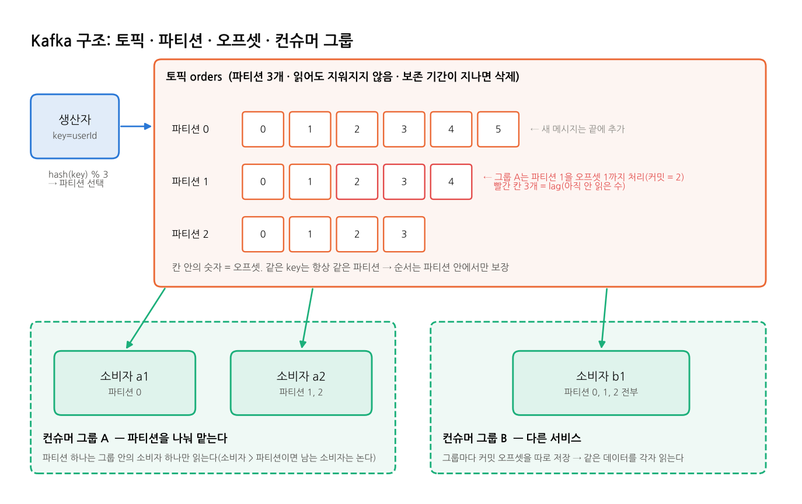

# Kafka

## 한 줄 요약
**메시지를 지우지 않고 순서대로 쌓는 분산 로그.** 대용량 이벤트를 빠르게 받아 두고, 여러 서비스가 각자 원하는 위치부터 읽어 간다.

## 등장 배경
- LinkedIn이 사이트의 활동 로그와 지표를 모으려고 만들었다. 2011년에 공개됐고 지금은 **Apache Kafka** 프로젝트다.
- 기존 MQ는 "소비하면 삭제"라서 같은 데이터를 여러 시스템(검색, 추천, 분석)이 각자 읽기 어려웠다. 처리량에도 한계가 있었다.
- Kafka는 메시지를 **디스크의 추가 전용 로그(append-only log)** 에 쌓아 순차 쓰기로 처리량을 높였다. 소비자는 각자 위치(오프셋)를 기억하며 읽는다.
- 예전에는 클러스터 관리에 ZooKeeper가 필요했다. 3.3부터 자체 합의 방식인 **KRaft**를 정식으로 쓸 수 있고, 이 프로젝트도 KRaft 단일 노드로 띄운다.

## 구조

| 용어 | 뜻 |
|---|---|
| **브로커(Broker)** | Kafka 서버 하나. 여러 대가 모여 클러스터가 된다 |
| **토픽(Topic)** | 메시지 분류 이름(예: `bench-topic`). 실제로는 파티션들의 묶음이다 |
| **파티션(Partition)** | 토픽을 나눈 단위. 각각이 독립된 로그이고, 파티션 수만큼 병렬로 쓰고 읽는다 |
| **오프셋(Offset)** | 파티션 안에서 메시지의 번호(0, 1, 2 ...). 순서와 위치를 나타낸다 |
| **key** | 메시지에 붙이는 값. `hash(key) % 파티션 수`로 파티션이 정해져, 같은 key는 항상 같은 파티션에 들어간다 |
| **컨슈머 그룹(Consumer Group)** | 같은 그룹의 소비자들이 파티션을 나눠 맡는다. 파티션 하나는 그룹 안의 소비자 하나만 읽는다 |
| **커밋 오프셋(Committed Offset)** | 그룹이 "여기까지 처리했다"고 Kafka에 저장한 위치. 재시작하면 여기서부터 읽는다 |
| **lag** | 마지막 오프셋 - 커밋 오프셋 = 아직 처리하지 않은 메시지 수. 소비가 밀리는지 보는 핵심 지표 |
| **리밸런스(Rebalance)** | 그룹에 소비자가 들어오거나 나가면 파티션 배정을 다시 하는 과정. 그동안 소비가 잠시 멈춘다 |
| **복제(Replication)** | 파티션을 여러 브로커에 복사해 장애에 대비한다(리더 1 + 팔로워). 이 프로젝트는 단일 노드라 1 |

## 메시지 흐름
1. **발행:** 생산자가 토픽에 key와 value를 보낸다. key로 파티션이 정해지고, 클라이언트가 여러 건을 묶어(batch) 보낸다.
2. **저장:** 브로커가 파티션 로그 끝에 추가하고 오프셋을 붙인다. `acks=all`이면 복제본까지 저장된 뒤 성공으로 응답한다.
3. **소비(pull):** 소비자가 `poll()`로 자기가 맡은 파티션에서 커밋 오프셋 다음부터 가져온다.
4. **커밋:** 처리 후 오프셋을 커밋한다(자동 또는 수동). 커밋 전에 죽으면 그 뒤 메시지가 다시 읽혀 at-least-once가 된다.
5. **보존:** 메시지는 소비와 상관없이 보존 기간(기본 7일)이나 크기 한도까지 남는다. 오프셋을 되감으면 다시 읽을 수 있다.

## 특징
| 항목 | 내용 |
|---|---|
| 전달 보장 | 기본은 at-least-once(처리 후 커밋). 멱등 프로듀서와 트랜잭션을 쓰면 Kafka 안에서 exactly-once |
| 전달 방식 | pull. 소비자가 자기 속도로 가져간다 |
| 순서 | **파티션 안에서만** 보장. 순서가 필요한 단위(사용자, 주문)를 key로 쓴다 |
| 영속성 | 디스크 로그 + 복제 |
| 보존 | 시간·크기 기준으로 삭제, 또는 key별 최신 값만 남기는 compaction |
| 확장 | 파티션과 브로커를 늘린다. 같은 그룹의 소비자 수는 파티션 수까지만 의미가 있다 |
| 생태계 | Kafka Connect(DB·외부 시스템 연동), Kafka Streams·Flink(스트림 처리), Schema Registry |

## 장점과 단점
| 장점 | 단점 |
|---|---|
| 처리량이 매우 높다(순차 쓰기, 배치, 파티션 병렬) | 운영이 복잡하다(파티션 설계, 브로커, 모니터링) |
| 메시지가 남아서 재처리(오프셋 되감기)가 쉽다 | 순서는 파티션 안에서만 보장된다 |
| 여러 서비스가 같은 데이터를 각자 읽을 수 있다(그룹만 다르게) | 파티션 수는 늘리기만 가능하고, 늘리면 key→파티션 배정이 바뀐다 |
| 디스크 기반이라 대량 데이터를 오래 보관한다 | 메시지 단위 라우팅, 우선순위, 지연 전송, 개별 재시도 같은 작업 큐 기능이 약하다 |
| 연동 생태계가 크다 | 적은 양에서는 배치 때문에 지연이 생길 수 있다(설정으로 조절) |

**잘 맞는 경우**
- 로그·클릭·지표 수집
- 이벤트 기반 아키텍처(주문 이벤트를 여러 서비스가 구독)
- CDC(DB 변경 전달), 실시간 스트림 처리
- 재처리가 필요한 데이터 파이프라인

**안 맞는 경우**
- 작은 서비스의 단순 작업 큐
- 메시지마다 다른 곳으로 보내는 복잡한 라우팅
- 운영 인력이 부족한 환경

## 이 프로젝트에서
| 항목 | 설정 |
|---|---|
| 브로커 | `apache/kafka:3.9.0`, KRaft 단일 노드, 호스트용 `localhost:39092`, 컨테이너용 `kafka:29092` |
| 토픽 | `bench-topic`, 파티션 10, 복제 1 |
| key | `userId`(같은 사용자 이벤트는 같은 파티션) |
| 컨슈머 그룹 | `bench-spring-group`(스레드 10), `bench-nest-group`(파티션 10개 동시 처리) |
| 처리 | Spring `@KafkaListener` 건별 처리. Nest `eachBatch`로 배치를 1,000건씩 병렬 처리 후 오프셋 확정과 heartbeat |
| 발행 | Spring `KafkaTemplate.send` 후 묶음마다 `flush`, Nest kafkajs `producer.send` |
| 코드 | Nest `nest/src/mq/kafka/`, Spring `spring/src/main/java/com/bench/mq/kafka/` |

**측정 결과 요약** (출처: [reports/scale-result.md](../../reports/scale-result.md), 4코어 머신, 10만 건 이상 기준)
- **A(대량 발행):** Spring에서 6개 규모 모두 1위다(약 7,000\~7,500 TPS). Nest도 약 6,900\~7,100 TPS로 Redis와 비슷한 최상위다. 두 앱 차이가 가장 작은 MQ다.
- **B(요청 1건 = 이벤트 1건, VU(동시 사용자) 100):** 처리량은 Redis 다음 2위다(Spring 약 2,460\~2,550, Nest 약 1,960\~2,150 TPS). Spring에서는 **300만 건에서도 p95가 0.1초대**로, 들어오는 즉시 처리됐다.

## 더 보기
- 실습(CLI, 코드 예제, 앱 API): [practice/kafka.md](../../practice/kafka.md)
- GUI(Kafka UI): [practice/gui.md](../../practice/gui.md#kafka-ui-kafka)
- 공식 문서: https://kafka.apache.org/documentation/
