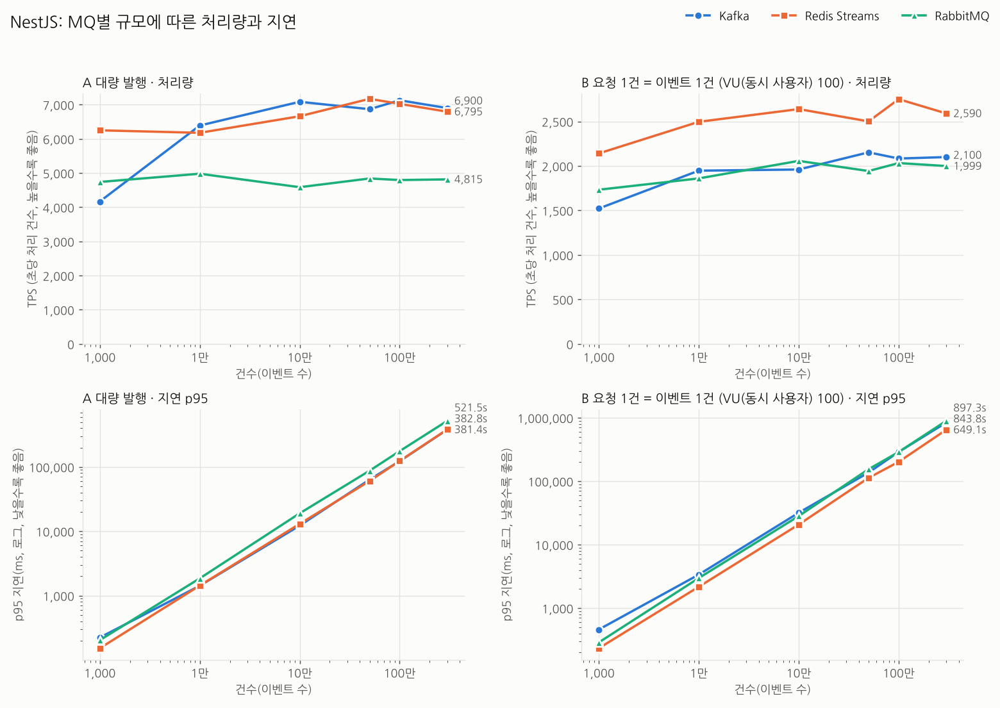
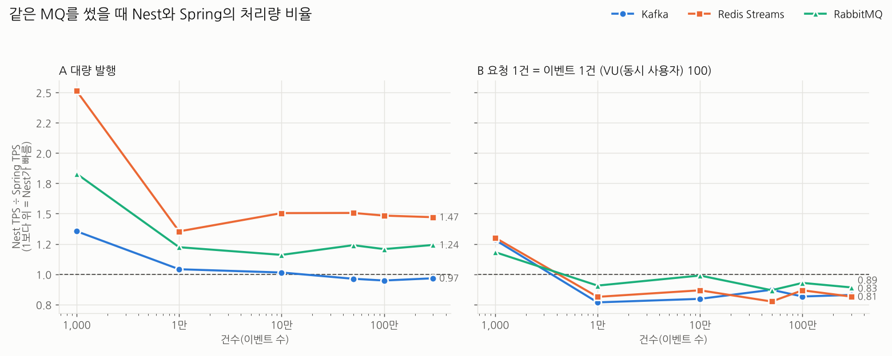

# MQ 규모별 성능 비교 결과 (Spring Boot vs NestJS, k6)

- 측정일: 2026-10-23
- 대상: Kafka 3.9(KRaft), Redis Streams(Redis 7), RabbitMQ 3. 모두 단일 노드
- 앱: Spring Boot 3.4.1 / Java 21, NestJS 10 / Node 22. 측정 시점 앱 코드는 커밋 `10253f9`(MQ별 모듈 분리 이후)
- 부하 도구: A는 `curl`, B는 **k6**
- 머신: 클라우드 컨테이너 1대(Intel Xeon 2.1GHz, **4코어**, 메모리 15GB). 브로커 4개, DB, 앱, 부하 도구가 같은 머신에서 돈다
- 측정 횟수: 앱마다 12개 시나리오 × MQ 3개 × 반복(1~5회) = **114회**, 두 앱 합계 228회. 모두 완료됐고 DB 저장 건수도 목표와 일치했다
- 원본: `scale-spring-raw.jsonl`, `scale-nest-raw.jsonl` / 상세 표: `scale-spring-tables.md`, `scale-nest-tables.md`, `scale-compare-tables.md`
- 시나리오 정의: `../SCENARIOS.md`

> 이 리포트의 수치는 4코어 머신 한 대에서 잰 값이다. 절대 수치보다 **같은 리포트 안의 상대 비교**로 본다.

## 한눈에 보기

| 질문 | 결과 |
|---|---|
| A(대량 발행)에서 가장 빠른 MQ | **Spring: Kafka** (6개 규모 모두 1위, 약 7,000~7,500 TPS) / **Nest: Kafka ≈ Redis** (약 7,000 TPS로 비슷, RabbitMQ는 약 4,800) |
| B(요청 1건 = 이벤트 1건)에서 처리량이 가장 높은 MQ | **두 앱 모두 Redis** (6개 규모 모두 1위) |
| B에서 지연이 가장 짧은 MQ | **Spring Kafka** (300만 건에서도 p95 0.1초). 대신 처리량은 Redis보다 약 20% 낮다 |
| 규모를 1만 → 300만으로 키우면 | 처리량(TPS)은 거의 그대로다. 1만~10만 건에서 이미 한계에 닿고 그 뒤로 평탄하다 |
| Spring과 Nest 중 빠른 쪽 | **A는 Nest가 약 1.2배**, **B는 Spring이 약 1.15배** 빠르다(1만 건 이상 기준) |
| MQ 순위가 앱에 따라 달라지나 | A에서 달라진다. Spring은 Kafka가 확실한 1위이고, Nest는 Kafka와 Redis가 비슷하다 |

## 측정 조건

| 항목 | 값 |
|---|---|
| 건수 | 1천, 1만, 10만, 50만, 100만, 300만 |
| 메시지 | 주문 JSON 256바이트 |
| DB 저장 | O (컨슈머가 MariaDB `orders_result`에 `INSERT IGNORE`) |
| 병렬도 | DB 풀 10, Kafka 파티션 10, Rabbit 컨슈머 10, Redis 컨슈머 10 |
| B의 VU(동시 사용자) | 100 |
| 반복 | 1천·1만 5회, 10만·50만 3회, 100만 2회, 300만 1회. MQ마다 워밍업 1회(기록 안 함) |

**방식 A와 B**
- **A (대량 발행):** `GET /bench/{mq}?count=N` 요청 **1번**으로 서버가 N건을 1,000건씩 묶어 발행한다. HTTP를 빼고 **MQ와 컨슈머가 쌓인 메시지를 얼마나 빨리 비우는지** 본다.
- **B (요청 1건 = 이벤트 1건):** k6가 `POST /orders`를 **총 N번** 보낸다. 요청마다 이벤트 1건을 발행한다. **API → MQ → 컨슈머 → DB 전체**가 사용자 요청을 얼마나 받아내는지 본다.

**VU(동시 사용자)란**
- 부하 도구가 만드는 가상 사용자 수다. 각 VU(동시 사용자)는 요청을 보내고 응답을 받으면 바로 다음 요청을 보낸다.
- 즉 VU(동시 사용자) 100은 **동시에 진행 중인 요청이 100개**라는 뜻이다. 전체 요청 수와는 별개다.
- B에서는 VU(동시 사용자) 100명이 **합계 N번**을 나눠서 보낸다(100 × N이 아니다).

**지표**
- **TPS:** 처리 건수 ÷ (첫 발행부터 마지막 DB 저장까지 걸린 시간). 초당 처리 건수이고 높을수록 좋다.
- **p95 지연:** 이벤트 생성부터 DB 저장 완료까지 걸린 시간의 95번째 백분위. 낮을수록 좋다.
- A는 발행이 소비보다 훨씬 빨리 끝나서, 지연에는 **큐에서 기다린 시간**이 대부분이다. 그래서 A의 지연은 건수에 비례해 커지고, MQ끼리 상대 비교로만 본다.

---

## 1. Spring Boot에서의 MQ 비교


### A 대량 발행: TPS (중앙값)
| 건수 | Kafka | Redis Streams | RabbitMQ | 1위 |
|---:|---:|---:|---:|---|
| 1천 | 3,077 | 2,488 | 2,591 | Kafka |
| 1만 | 6,139 | 4,564 | 4,073 | Kafka |
| 10만 | 6,988 | 4,429 | 3,956 | Kafka |
| 50만 | 7,138 | 4,763 | 3,906 | Kafka |
| 100만 | 7,521 | 4,734 | 3,972 | Kafka |
| 300만 | 7,141 | 4,621 | 3,879 | Kafka |

### B 요청 1건 = 이벤트 1건, VU(동시 사용자) 100: TPS와 p95
| 건수 | Kafka TPS | Redis TPS | RabbitMQ TPS | Kafka p95 | Redis p95 | RabbitMQ p95 |
|---:|---:|---:|---:|---:|---:|---:|
| 1천 | 1,186 | **1,645** | 1,466 | 0.14초 | 0.34초 | 0.27초 |
| 1만 | 2,537 | **3,070** | 2,053 | 0.22초 | 0.89초 | 0.51초 |
| 10만 | 2,461 | **3,044** | 2,080 | 0.15초 | 9.4초 | 0.74초 |
| 50만 | 2,471 | **3,229** | 2,239 | 0.12초 | 44초 | 1.6초 |
| 100만 | 2,553 | **3,172** | 2,190 | 0.12초 | 95초 | 3.7초 |
| 300만 | 2,534 | **3,178** | 2,244 | **0.11초** | 293초 | 6.1초 |

**정리**
- **A에서는 Kafka가 모든 규모에서 1위**다. 1만 건 이상에서 Redis보다 약 1.35~1.6배, RabbitMQ보다 약 1.5~1.9배 빠르다.
- **B에서는 Redis가 처리량 1위**이지만, 건수가 늘수록 지연이 계속 쌓인다(300만 건에서 p95 293초). 요청은 Redis 컨슈머가 비우는 속도보다 빨리 들어오는데, 컨슈머가 따라가지 못해 큐에 쌓이고 있다는 뜻이다.
- **B의 Spring Kafka는 처리량은 2위지만 지연이 거의 늘지 않는다**(0.1초대). 컨슈머 처리 능력에 여유가 있어 들어오는 즉시 처리한다. 이때 TPS의 한계는 발행 쪽으로 보인다. 요청마다 `send` 후 `flush`로 브로커 응답을 기다리기 때문이다.
- RabbitMQ는 두 방식 모두 처리량 3위다. B에서는 지연이 천천히 늘었다(300만 건에서 6초).

## 2. NestJS에서의 MQ 비교



### A 대량 발행: TPS (중앙값)
| 건수 | Kafka | Redis Streams | RabbitMQ | 1위 |
|---:|---:|---:|---:|---|
| 1천 | 4,167 | 6,250 | 4,739 | Redis |
| 1만 | 6,390 | 6,177 | 4,980 | Kafka |
| 10만 | 7,085 | 6,662 | 4,586 | Kafka |
| 50만 | 6,868 | 7,171 | 4,841 | Redis |
| 100만 | 7,129 | 7,023 | 4,795 | Kafka |
| 300만 | 6,900 | 6,795 | 4,815 | Kafka |

### B 요청 1건 = 이벤트 1건, VU(동시 사용자) 100: TPS와 p95
| 건수 | Kafka TPS | Redis TPS | RabbitMQ TPS | Kafka p95 | Redis p95 | RabbitMQ p95 |
|---:|---:|---:|---:|---:|---:|---:|
| 1천 | 1,522 | **2,141** | 1,733 | 0.46초 | 0.23초 | 0.29초 |
| 1만 | 1,947 | **2,496** | 1,860 | 3.4초 | 2.2초 | 3.0초 |
| 10만 | 1,960 | **2,639** | 2,057 | 32초 | 21초 | 28초 |
| 50만 | 2,153 | **2,501** | 1,943 | 137초 | 113초 | 155초 |
| 100만 | 2,083 | **2,750** | 2,032 | 290초 | 202초 | 289초 |
| 300만 | 2,100 | **2,590** | 1,999 | 844초 | 649초 | 897초 |

**정리**
- **A에서는 Kafka와 Redis가 거의 같다**(1만 건 이상에서 차이 약 6% 안쪽, 1위가 번갈아 바뀜). RabbitMQ는 약 30% 낮다.
- **B에서는 Redis가 처리량과 지연 모두 1위**다.
- **B에서는 세 MQ 모두 지연이 건수에 비례해 쌓인다.** Nest는 HTTP 요청 처리와 세 MQ 컨슈머가 **같은 이벤트 루프 하나**를 나눠 쓴다. 그래서 요청이 몰리면 소비가 밀린다. 요청은 받아 두고(202 응답) 처리는 나중에 하는 구조라, 사용자는 빠르게 응답받지만 실제 저장은 늦어진다.

## 3. Spring vs Nest: 같은 MQ를 썼을 때



### TPS 비율 (Nest ÷ Spring, 1보다 크면 Nest가 빠름)
| 건수 | A Kafka | A Redis | A RabbitMQ | B Kafka | B Redis | B RabbitMQ |
|---:|---:|---:|---:|---:|---:|---:|
| 1천 | 1.35 | **2.51** | 1.83 | 1.28 | 1.30 | 1.18 |
| 1만 | 1.04 | 1.35 | 1.22 | 0.77 | 0.81 | 0.91 |
| 10만 | 1.01 | 1.50 | 1.16 | 0.80 | 0.87 | 0.99 |
| 50만 | 0.96 | 1.51 | 1.24 | 0.87 | 0.77 | 0.87 |
| 100만 | 0.95 | 1.48 | 1.21 | 0.82 | 0.87 | 0.93 |
| 300만 | 0.97 | 1.47 | 1.24 | 0.83 | 0.81 | 0.89 |

### 구분별 요약 (기하평균)
| 구분 | Nest/Spring | 해석 |
|---|---:|---|
| 전체 36케이스 | 1.08 | 전체로는 비슷하지만 방식에 따라 갈린다 |
| A 대량 발행 | **1.29** | Nest가 빠름 (1천 건을 빼면 약 1.21) |
| B 요청 1건 = 이벤트 1건 | **0.91** | Spring이 빠름 (1천 건을 빼면 약 0.85) |
| Kafka | 0.96 | 거의 같음. 100만 건 이상 A에서는 Spring이 약간 앞섬 |
| Redis Streams | 1.19 | A에서는 Nest가 약 1.5배, B에서는 Spring이 약 1.2배 |
| RabbitMQ | 1.11 | A는 Nest, B는 Spring |

5회 측정 범위가 겹치지 않아 우열이 분명한 케이스는 Spring 15개, Nest 13개, 구분 어려움 8개다.

### 지연 비교 (B, p95)
| 건수 | Spring Kafka | Nest Kafka | Spring Redis | Nest Redis | Spring RabbitMQ | Nest RabbitMQ |
|---:|---:|---:|---:|---:|---:|---:|
| 10만 | 0.15초 | 32초 | 9.4초 | 21초 | 0.74초 | 28초 |
| 100만 | 0.12초 | 290초 | 95초 | 202초 | 3.7초 | 289초 |
| 300만 | 0.11초 | 844초 | 293초 | 649초 | 6.1초 | 897초 |

B에서 Spring은 처리량이 더 높고 **지연은 훨씬 짧다**. Kafka는 수백~수천 배, RabbitMQ는 수십~백여 배, Redis는 약 2배 차이가 난다.

**정리**
- **A(쌓인 메시지 비우기)는 Nest가 유리**하다. 그중 Redis 차이가 가장 크다(약 1.5배). Nest의 Redis 컨슈머는 최대 100건을 읽어 `Promise.all`로 병렬 처리한 뒤 한 번에 ack한다. Spring은 건별로 처리하고 건마다 ack한다. 이 **구현 방식 차이**가 런타임 차이보다 크게 작용한 것으로 보인다. 두 방식은 각 프레임워크에서 흔히 쓰는 방식을 따른 것이고 바꿀 수 있다. 처리 방식을 맞춘 측정은 하지 않았다.
- **B(요청이 몰리는 API)는 Spring이 유리**하다. Spring은 Tomcat 스레드가 HTTP를 받고 컨슈머는 별도 스레드에서 돈다. Nest는 이벤트 루프 하나가 둘 다 처리해서, 요청이 몰리면 소비가 밀리고 지연이 쌓인다.
- **Kafka는 두 앱이 거의 같다.** 클라이언트 구현(spring-kafka vs kafkajs)과 소비 방식의 차이가 결과에 크게 드러나지 않았다.

---

## 4. 규모가 커질 때의 변화

- **처리량은 1만~10만 건부터 평탄하다.** 10만 → 300만 건 사이에서 TPS 변화는 대부분 ±5% 안이다. 이 머신에서는 그 정도 규모에서 이미 처리 한계(DB 풀 10, CPU 4코어)에 닿는다는 뜻이다. 오래 돌려도 처리량이 떨어지지는 않았다.
- **1천 건은 따로 본다.** 실행이 1초 안팎이라 시작과 끝의 고정 비용이 커서 TPS가 낮고 편차가 크다. 1천 건에서만 Nest가 B에서도 앞서는 것도 이 영향이다.
- **MQ 순위는 규모에 따라 거의 바뀌지 않는다.** Spring A는 6개 규모 모두 Kafka 1위, B는 모두 Redis 1위다. Nest A만 Kafka와 Redis가 번갈아 1위를 했다.
- **지연은 규모에 비례해 커진다.** 처리 속도보다 빨리 들어오는 만큼 큐에 쌓이기 때문이다. 예외는 Spring B의 Kafka로, 소비가 유입을 따라가서 300만 건에서도 0.1초대를 유지했다.

## 5. 어떻게 고르면 되나 (이 측정 기준)

| 상황 | 권장 | 근거 |
|---|---|---|
| 로그·이벤트를 대량으로 모아 빠르게 비워야 함 (A형) | **Kafka** (Spring이든 Nest든) | 두 앱 모두 최고 수준(약 7,000 TPS), 앱에 따른 차이가 가장 작음 |
| Nest로 대량 처리 | Kafka 또는 Redis Streams | Nest에서는 둘이 같은 수준. Redis는 별도 브로커 없이 쓸 수 있음 |
| 주문 같은 API에서 저장까지 빨리 끝나야 함 (B형, 지연 중요) | **Spring + Kafka** | 처리량은 2위지만 p95가 규모와 무관하게 0.1초대 |
| API 처리량만 최대 (B형, 지연은 감수) | Redis Streams | 두 앱 모두 B 처리량 1위. 단, 컨슈머가 밀려 지연이 계속 쌓인다 |
| RabbitMQ | 특별한 이유(라우팅, 기존 인프라)가 있을 때 | 처리량은 대부분 3위. Spring B에서는 지연이 Redis보다 짧음 |

## 6. 한계

- 4코어 머신 한 대에서 브로커 4개, DB, 앱, 부하 도구가 자원을 나눠 쓴다. 실제 운영 환경과 절대 수치가 다르다.
- 앱 하나가 발행과 소비를 함께 한다. 서비스를 분리하면 결과가 달라질 수 있다. 특히 B에서 Nest의 지연은 이 구조 영향이 크다.
- 두 앱의 컨슈머 구현이 같지 않다. 각 프레임워크의 흔한 방식을 따른 결과로, Nest는 묶어서 동시 처리하고 Spring은 스레드마다 건별 처리한다. 그래서 Spring과 Nest의 차이는 런타임 차이와 구현 차이가 섞인 결과다. 자세히: [Nest vs Spring 개념 7절](../docs/nest-vs-spring-concepts.md)
- 반복 횟수가 1~5회라 통계 검정은 하지 않았다. 100만·300만 건은 1~2회라 경향으로만 본다.
- 브로커와 클라이언트 튜닝(Kafka `linger.ms`, Rabbit publisher confirm, Redis 파이프라인 크기 등)은 하지 않았다.
- 이 리포트는 이전 측정(2026-10-09)을 대체한다. 머신과 코드가 달라 이전 수치와 직접 비교하지 않는다.

## 재현

```bash
docker compose down -v && docker compose up -d
cd spring && ./gradlew build -x test && java -jar build/libs/mq-bench-spring-0.0.1.jar &
OUT=reports/scale-spring-raw.jsonl ./scenarios.sh spring      # 약 3.5시간
# Spring을 끄고 docker compose down -v && up -d 후
cd nest && npm run build && node dist/main.js &
OUT=reports/scale-nest-raw.jsonl ./scenarios.sh nest          # 약 3.5시간

python3 report.py reports/scale-spring-raw.jsonl > reports/scale-spring-tables.md
python3 report.py reports/scale-nest-raw.jsonl > reports/scale-nest-tables.md
python3 compare.py reports/scale-spring-raw.jsonl reports/scale-nest-raw.jsonl > reports/scale-compare-tables.md
python3 charts.py reports/scale-spring-raw.jsonl reports/scale-nest-raw.jsonl   # reports/img/*.png
```
